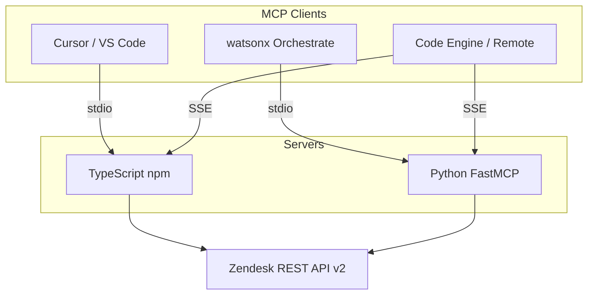
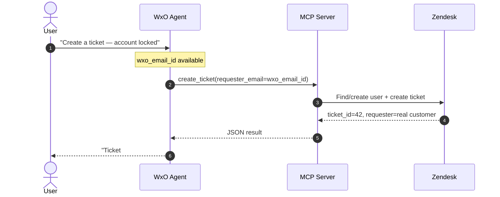

<!--
SEO: Zendesk MCP | Model Context Protocol Server | AI Agents Zendesk Support Tickets
zendesk, zendesk-api, zendesk-mcp, zendesk-support, zendesk-tickets, mcp, mcp-server, model-context-protocol, cursor, vscode, claude, claude-desktop, github-copilot, ai-agent, ai-agents, tool-calling, customer-support, helpdesk, support-tickets, ticketing, crm, typescript, python, fastmcp, watsonx-orchestrate, ibm-code-engine, npm, npx, stdio, sse, automation
-->

# Zendesk MCP

[](https://www.npmjs.com/package/@markusvankempen/zendesk-mcp-server)
[](https://www.npmjs.com/package/@markusvankempen/zendesk-mcp-server)
[](https://pypi.org/project/zendesk-mcp-server-py/)
[](https://marketplace.visualstudio.com/items?itemName=markusvankempen.zendesk-mcp-vscode)
[](https://registry.modelcontextprotocol.io/servers/io.github.markusvankempen%2Fzendesk-mcp)
[](https://github.com/markusvankempen/zendesk-mcp/actions/workflows/ci.yml)
[](LICENSE)

<p align="center">
  
</p>

<p align="center">
  <a href="cursor://anysphere.cursor-deeplink/mcp/install?name=Zendesk%20MCP&config=eyJjb21tYW5kIjoibnB4IiwiYXJncyI6WyIteSIsIkBtYXJrdXN2YW5rZW1wZW4vemVuZGVzay1tY3Atc2VydmVyIl0sImVudiI6eyJaRU5ERVNLX1NVQkRPTUFJTiI6InlvdXItc3ViZG9tYWluIiwiWkVOREVTS19FTUFJTCI6ImJvdEBleGFtcGxlLmNvbSIsIlpFTkRFU0tfQVBJX1RPS0VOIjoieW91ci16ZW5kZXNrLWFwaS10b2tlbiJ9fQ=="></a>
  &nbsp;
  <a href="https://vscode.dev/redirect/mcp/install?name=zendesk-mcp&config=%7B%22command%22%3A%22npx%22%2C%22args%22%3A%5B%22-y%22%2C%22%40markusvankempen/zendesk-mcp-server%22%5D%2C%22env%22%3A%7B%22ZENDESK_SUBDOMAIN%22%3A%22your-subdomain%22%2C%22ZENDESK_EMAIL%22%3A%22bot%40example.com%22%2C%22ZENDESK_API_TOKEN%22%3A%22your-zendesk-api-token%22%7D%7D"></a>
  &nbsp;
  <a href="https://github.com/markusvankempen/zendesk-mcp/blob/main/docs/ide/bob-local.md#step-by-step-npx-from-npm-option-a"></a>
  &nbsp;
  <a href="https://github.com/markusvankempen/zendesk-mcp/blob/main/docs/ide/antigravity-local.md#step-by-step-npx-from-npm-option-a"></a>
</p>

> **Model Context Protocol (MCP) server for Zendesk Support** — connect AI agents in **Cursor**, **VS Code**, **Claude Desktop**, **watsonx Orchestrate**, and **IBM Code Engine** to 14 ticket tools (create, search, assign, close, comments, metrics). Install: `npx @markusvankempen/zendesk-mcp-server` · `pip install zendesk-mcp-server-py`

`zendesk` · `mcp` · `cursor` · `github-copilot` · `claude` · `ai-agents` · `customer-support` · `helpdesk` · `watsonx-orchestrate` · `typescript` · `python`

Generic Zendesk integration for AI agents via the [Model Context Protocol (MCP)](https://modelcontextprotocol.io). Ships **TypeScript** and **Python** server implementations plus deployment examples for IDEs, IBM Code Engine, and watsonx Orchestrate.

**Author:** Markus van Kempen  
**Email:** [markus.van.kempen@gmail.com](mailto:markus.van.kempen@gmail.com) · [mvk@ca.ibm.com](mailto:mvk@ca.ibm.com)  
**Website:** [markusvankempen.github.io](https://markusvankempen.github.io/)  
*No bug too small, no syntax too weird.*

---

## Overview

Zendesk MCP exposes 14 support-ticket operations as MCP tools so AI agents in **Cursor**, **VS Code**, **Claude Desktop**, **watsonx Orchestrate**, and **IBM Code Engine** can manage tickets through natural language.

The core design solves **requester attribution**: tickets are created with the real customer as requester (not the API service account), so Zendesk email replies route correctly.



📖 **[Documentation hub → docs/](./docs/README.md)** · **[MCP config examples → examples/mcp/](./examples/mcp/README.md)** · **[Public vs private repo → docs/PUBLIC_REPO.md](./docs/PUBLIC_REPO.md)** · **[Contributing → CONTRIBUTING.md](./CONTRIBUTING.md)** · **[Security → docs/SECURITY.md](./docs/SECURITY.md)**

---

## Documentation reference

Complete index of every markdown file in this repository.

### Root

| Document | Description |
|----------|-------------|
| [README.md](./README.md) | Project overview, quick starts, deployments summary *(this file)* |
| [task.md](./task.md) | Original project requirements and reference notes |

### Core documentation (`docs/`)

| Document | Description |
|----------|-------------|
| [docs/README.md](./docs/README.md) | **Documentation hub** — start here |
| [docs/ide/README.md](./docs/ide/README.md) | IDE setup — local `npx` + remote Code Engine |
| [docs/reference/ARCHITECTURE.md](./docs/reference/ARCHITECTURE.md) | System design, stdio/SSE/WxO topologies, auth flow |
| [docs/reference/TOOLS.md](./docs/reference/TOOLS.md) | All 14 MCP tools — parameters, returns, examples |
| [docs/guides/SCENARIOS.md](./docs/guides/SCENARIOS.md) | Requester modes, role agents, 17 scenarios, E2E |
| [docs/reference/FILES.md](./docs/reference/FILES.md) | Complete file inventory |
| [docs/deployments/README.md](./docs/deployments/README.md) | Deployment docs index |

### Package READMEs (`packages/`)

| Document | Description |
|----------|-------------|
| [packages/zendesk-mcp-server/README.md](./packages/zendesk-mcp-server/README.md) | TypeScript/npm server — install, env vars, SSE mode, build from source |
| [packages/zendesk-mcp-server-py/README.md](./packages/zendesk-mcp-server-py/README.md) | Python FastMCP server — setup, SSE mode, WxO import pointer |

### Deployment READMEs (`deployments/`)

| Document | Description |
|----------|-------------|
| [deployments/vscode-extension/README.md](./deployments/vscode-extension/README.md) | VS Code / Cursor / Open VSX extension — commands, settings, publish |
| [deployments/code-engine/README.md](./deployments/code-engine/README.md) | IBM Code Engine — Dockerfiles, SSE endpoints, remote MCP client config |
| [deployments/code-engine/DEPLOYMENT-GUIDE.md](./deployments/code-engine/DEPLOYMENT-GUIDE.md) | Code Engine — live deploy, test/admin UI, **local vs deployed `mcp.json`** |
| [deployments/watsonx-orchestrate/README.md](./deployments/watsonx-orchestrate/README.md) | WxO toolkit deploy, 4 role agents, scenario runner, CLI test commands |

### Quick navigation by topic

| Topic | Start here |
|-------|------------|
| **IDE setup (local `npx`)** | [docs/ide/README-local.md](./docs/ide/README-local.md) |
| **IDE setup (Code Engine)** | [docs/ide/README-remote.md](./docs/ide/README-remote.md) |
| Architecture & transports | [docs/reference/ARCHITECTURE.md](./docs/reference/ARCHITECTURE.md) |
| Tool parameters & examples | [docs/reference/TOOLS.md](./docs/reference/TOOLS.md) |
| WxO agents & test scenarios | [docs/guides/SCENARIOS.md](./docs/guides/SCENARIOS.md) |
| Every file explained | [docs/reference/FILES.md](./docs/reference/FILES.md) |
| npm / TypeScript server | [packages/zendesk-mcp-server/README.md](./packages/zendesk-mcp-server/README.md) |
| Python / FastMCP server | [packages/zendesk-mcp-server-py/README.md](./packages/zendesk-mcp-server-py/README.md) |
| IDE extension setup | [deployments/vscode-extension/README.md](./deployments/vscode-extension/README.md) |
| Code Engine deploy | [deployments/code-engine/README.md](./deployments/code-engine/README.md) |
| WxO deploy & E2E | [deployments/watsonx-orchestrate/README.md](./deployments/watsonx-orchestrate/README.md) |

---

## Repository layout

```
zendesk-mcp/
├── docs/                         # Documentation hub
│   ├── README.md                 # Start here
│   ├── ide/                      # IDE setup guides (local + remote)
│   ├── reference/                # ARCHITECTURE, TOOLS, FILES
│   ├── guides/                   # SCENARIOS
│   └── deployments/              # Deployment index
├── packages/
│   ├── zendesk-mcp-server/       # TypeScript MCP server (npm)
│   └── zendesk-mcp-server-py/    # Python MCP server (FastMCP)
├── deployments/
│   ├── vscode-extension/         # VS Code / Cursor / Open VSX extension
│   ├── code-engine/              # IBM Code Engine (SSE) + mcp-client JSON
│   └── watsonx-orchestrate/      # WxO toolkit + 4 role agents
└── .github/workflows/            # CI + npm/marketplace publish
```

---

## Quick start (TypeScript / npm)

```bash
export ZENDESK_SUBDOMAIN=your-subdomain
export ZENDESK_EMAIL=agent@example.com
export ZENDESK_API_TOKEN=your_token

npx @markusvankempen/zendesk-mcp-server
```

**One-click install:** [Cursor](cursor://anysphere.cursor-deeplink/mcp/install?name=Zendesk%20MCP&config=eyJjb21tYW5kIjoibnB4IiwiYXJncyI6WyIteSIsIkBtYXJrdXN2YW5rZW1wZW4vemVuZGVzay1tY3Atc2VydmVyIl0sImVudiI6eyJaRU5ERVNLX1NVQkRPTUFJTiI6InlvdXItc3ViZG9tYWluIiwiWkVOREVTS19FTUFJTCI6ImJvdEBleGFtcGxlLmNvbSIsIlpFTkRFU0tfQVBJX1RPS0VOIjoieW91ci16ZW5kZXNrLWFwaS10b2tlbiJ9fQ==) · [VS Code](https://vscode.dev/redirect/mcp/install?name=zendesk-mcp&config=%7B%22command%22%3A%22npx%22%2C%22args%22%3A%5B%22-y%22%2C%22%40markusvankempen/zendesk-mcp-server%22%5D%2C%22env%22%3A%7B%22ZENDESK_SUBDOMAIN%22%3A%22your-subdomain%22%2C%22ZENDESK_EMAIL%22%3A%22bot%40example.com%22%2C%22ZENDESK_API_TOKEN%22%3A%22your-zendesk-api-token%22%7D%7D) — then set your `ZENDESK_*` credentials in MCP settings.

**Copy-paste setup:** [Bob](./docs/ide/bob-local.md) · [Antigravity](./docs/ide/antigravity-local.md) (no install deeplink yet — use [examples/mcp/](./examples/mcp/README.md)):

Add to your IDE config — copy from [examples/mcp/](./examples/mcp/README.md):

| IDE | File |
|-----|------|
| Cursor | [examples/mcp/cursor-local.json](./examples/mcp/cursor-local.json) → `~/.cursor/mcp.json` |
| VS Code | [examples/mcp/vscode-local.json](./examples/mcp/vscode-local.json) → `User/mcp.json` |
| Bob | [examples/mcp/bob-local.json](./examples/mcp/bob-local.json) |
| Antigravity | [examples/mcp/antigravity-local.json](./examples/mcp/antigravity-local.json) |
| Claude Desktop | [examples/mcp/claude-desktop-local.json](./examples/mcp/claude-desktop-local.json) |

Or use the **VS Code extension** — it stores your API token in OS keychain and writes MCP config automatically. See [deployments/vscode-extension/README.md](./deployments/vscode-extension/README.md).

Before pushing to GitHub, run `npm run check:secrets` — see [docs/SECURITY.md](./docs/SECURITY.md).

---

## Quick start (Python)

```bash
pip install zendesk-mcp-server-py

export ZENDESK_SUBDOMAIN=your-subdomain
export ZENDESK_EMAIL=agent@example.com
export ZENDESK_API_TOKEN=your_token

zendesk-mcp-server-py
```

---

## MCP tools (14)

| Tool | Description |
|------|-------------|
| `create_ticket` | Create ticket with correct requester attribution |
| `get_ticket` | Get ticket by ID |
| `update_ticket` | Update status, priority, tags, or comment |
| `search_tickets` | Zendesk search query syntax |
| `list_recent_tickets` | Recently updated tickets |
| `list_all_tickets` | Admin-wide ticket listing |
| `list_tickets_for_requester` | Tickets for a requester email |
| `get_ticket_comments` | Read ticket conversation |
| `add_ticket_comment` | Add public reply or internal note |
| `get_user_by_email` | Look up Zendesk user |
| `close_ticket` | Mark ticket solved |
| `reopen_ticket` | Reopen solved/closed ticket |
| `get_ticket_metrics` | SLA / timing metrics |
| `assign_ticket` | Assign to group or agent |

→ [Full tool reference with parameters & examples](./docs/reference/TOOLS.md)

---

## Deployments

| Scenario | Directory | Transport | Docs |
|----------|-----------|-----------|------|
| VS Code / Cursor / Open VSX | `deployments/vscode-extension/` | stdio via `npx` | [README](./deployments/vscode-extension/README.md) |
| IBM Code Engine | `deployments/code-engine/` | SSE | [README](./deployments/code-engine/README.md) |
| watsonx Orchestrate | `deployments/watsonx-orchestrate/` | stdio subprocess | [README](./deployments/watsonx-orchestrate/README.md) · [Scenarios](./docs/guides/SCENARIOS.md) |

### watsonx Orchestrate — role agents

| Agent | Role |
|-------|------|
| `zendesk_end_user_agent` | Self-service — create/list/comment on own tickets |
| `zendesk_support_agent` | Analyst — triage, investigate, metrics, assign |
| `zendesk_admin_agent` | Admin — queue overview, SLA, assignment |
| `zendesk_mcp_agent` | Generalist — all tools, prototyping |

```bash
cd deployments/watsonx-orchestrate
./deploy_and_test.sh                              # full deploy + E2E
RUN_LIVE=1 ./run_agent_scenarios.sh               # 17 role scenarios
```

---

## Requester attribution (key design)



Connection credentials (`ZENDESK_*`) authenticate the API. User identity (`wxo_email_id`) is mapped by the **agent** into tool arguments — the MCP server never sees WxO session context directly.

→ [Full scenarios documentation](./docs/guides/SCENARIOS.md)

---

## Development

```bash
npm install
npm run build          # TypeScript server + VS Code extension
npm run build:server   # TypeScript server only
npm run build:extension
```

---

## Credentials

Never commit `.env` files or API tokens.

| Deployment | Secret storage |
|------------|---------------|
| IDE extension | VS Code `SecretStorage` (OS keychain) |
| Code Engine | `ibmcloud ce` secrets / env vars |
| WxO | `orchestrate connections set-credentials` |
| Local dev | `packages/zendesk-mcp-server-py/.env` |

| Variable | Purpose |
|----------|---------|
| `ZENDESK_SUBDOMAIN` | Tenant prefix (`mycompany` → `mycompany.zendesk.com`) |
| `ZENDESK_EMAIL` | Service account email for API auth |
| `ZENDESK_API_TOKEN` | Zendesk API token |

---

## Reference implementation

Extracted and generalized from `WxO-ToolBox/vsc/test_tools/zendesk_mcp_server`. See [docs/reference/FILES.md](./docs/reference/FILES.md) for lineage mapping.

→ [All documentation](./docs/README.md) · [task.md](./task.md) (original requirements)

---

## Contributing

See [CONTRIBUTING.md](./CONTRIBUTING.md) and [CODE_OF_CONDUCT.md](./CODE_OF_CONDUCT.md).

## License

[Apache License 2.0](./LICENSE)

---

## Links

- **npm:** [@markusvankempen/zendesk-mcp-server](https://www.npmjs.com/package/@markusvankempen/zendesk-mcp-server)
- **PyPI:** [zendesk-mcp-server-py](https://pypi.org/project/zendesk-mcp-server-py/)
- **GitHub (docs):** [markusvankempen/zendesk-mcp](https://github.com/markusvankempen/zendesk-mcp)
- **MCP examples:** [examples/mcp/](./examples/mcp/README.md)

## More from the author

Part of the open-source toolkit at [markusvankempen.github.io](https://markusvankempen.github.io/) — alongside [WxO Agent MCP](https://github.com/markusvankempen/wxo-agent-mcp), [Maximo MCP Server](https://github.com/markusvankempen/maximo-mcp-server), [Code Engine MCP Server](https://github.com/markusvankempen/code-engine-mcp-server), and [WxO Builder MCP Server](https://github.com/markusvankempen/wxo-builder-mcp-server).

---

## Topics & keywords

`zendesk` · `zendesk-api` · `zendesk-mcp` · `zendesk-support` · `zendesk-tickets` · `mcp` · `mcp-server` · `model-context-protocol` · `cursor` · `claude` · `claude-desktop` · `github-copilot` · `vscode` · `vscode-extension` · `open-vsx` · `ai-agent` · `ai-agents` · `tool-calling` · `function-calling` · `llm-tools` · `customer-support` · `customer-service` · `helpdesk` · `help-desk` · `service-desk` · `support-tickets` · `ticketing` · `crm` · `watsonx` · `watsonx-orchestrate` · `ibm-cloud` · `ibm-code-engine` · `typescript` · `python` · `fastmcp` · `stdio` · `sse` · `npx` · `npm-package` · `automation`

---

**Author:** Markus van Kempen  
**Email:** [markus.van.kempen@gmail.com](mailto:markus.van.kempen@gmail.com) · [mvk@ca.ibm.com](mailto:mvk@ca.ibm.com)  
**Website:** [markusvankempen.github.io](https://markusvankempen.github.io/)  
*No bug too small, no syntax too weird.*

---

> **Public distribution repo** — server source is not included. Install via
> `npx -y @markusvankempen/zendesk-mcp-server` or `pip install zendesk-mcp-server-py`.
> See [docs/PUBLIC_REPO.md](./docs/PUBLIC_REPO.md) for the private dev workflow.
