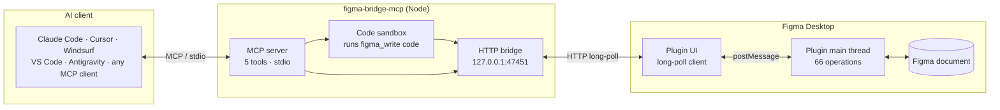
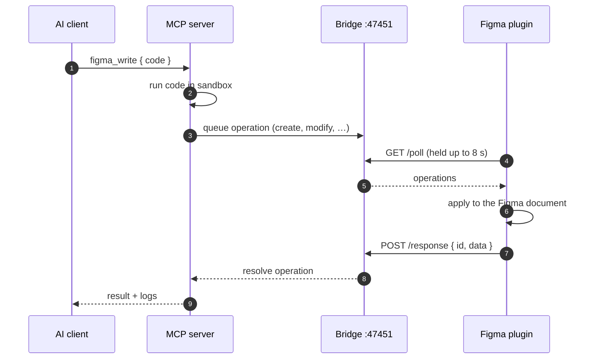
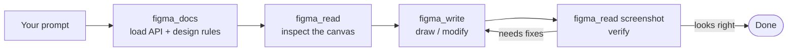
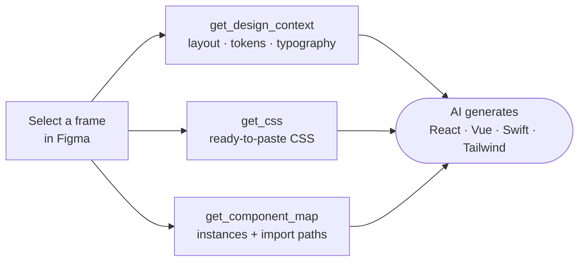
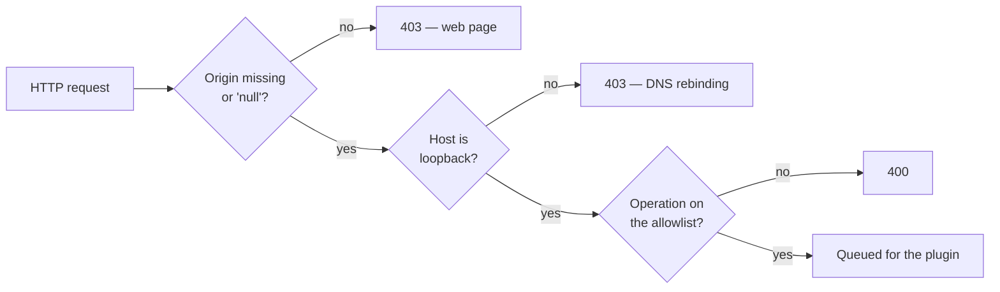

<div align="center">


### Let AI draw on your Figma canvas — and read your designs back as code.

A bidirectional [Model Context Protocol](https://modelcontextprotocol.io) bridge for **Figma Desktop**.<br/>
No Figma API key. No cloud. Everything runs on `localhost`.

[](https://www.npmjs.com/package/@hanoilab/figma-bridge-mcp)
[](https://github.com/nguyendinhphongdx/figma-bridge-mcp/actions/workflows/release.yml)
[](package.json)
[](https://registry.modelcontextprotocol.io)
[](LICENSE)

[Quick start](#quick-start) · [How it works](#how-it-works) · [Tools](#tools) · [Security](#security-model) · [Troubleshooting](#troubleshooting) · [Changelog](CHANGELOG.md)

</div>

> **Not affiliated with, endorsed by, or sponsored by Figma, Inc.** "Figma" is a trademark of Figma, Inc., used here only to describe compatibility.

---

## Overview

`figma-bridge-mcp` connects an AI assistant to the document you have open in Figma Desktop.

| | |
|---|---|
| ✍️ **Write** | The AI runs JavaScript against a `figma.*` API to create frames, text, vectors, components, variables, prototypes. |
| 👀 **Read** | The AI extracts node trees, resolved design tokens, CSS, component maps and screenshots — ready for design-to-code. |
| 🔒 **Local** | The bridge listens on `127.0.0.1` only. Nothing leaves your machine. |
| 🧩 **Any MCP client** | ✅ Tested with Claude Code and Antigravity. 🔧 Compatible with Cursor, VS Code, Windsurf, Zed and any stdio MCP client. |

> **Requires Figma Desktop.** The plugin talks to the server over `localhost`, which Figma's web app does not allow.

---

## How it works

Three parts cooperate: your **AI client**, the **MCP server** (Node), and the **Figma plugin** (inside Figma Desktop). The plugin polls the server, so no inbound connection to Figma is ever needed.



### One round trip

The server holds each poll open for up to 8 s and answers the moment work is queued, so latency is typically under 100 ms.



### Several Figma files at once

Each open plugin instance registers its own **session**. Pass the optional `sessionId` to `figma_write` / `figma_read` to target a specific file; if that session is not connected the call fails instead of writing into another file.

---

## Quick start

### 1 · Add the MCP server to your client

<details open>
<summary><strong>Claude Code</strong></summary>

```bash
claude mcp add figma-bridge-mcp -- npx @hanoilab/figma-bridge-mcp          # this project
claude mcp add --scope user figma-bridge-mcp -- npx @hanoilab/figma-bridge-mcp   # all projects
```
</details>

<details>
<summary><strong>Claude Desktop</strong></summary>

Edit `~/Library/Application Support/Claude/claude_desktop_config.json` (macOS) or `%APPDATA%\Claude\claude_desktop_config.json` (Windows):

```json
{
  "mcpServers": {
    "figma": { "command": "npx", "args": ["-y", "@hanoilab/figma-bridge-mcp"] }
  }
}
```
</details>

<details>
<summary><strong>Cursor</strong></summary>

Edit `.cursor/mcp.json` (project) or `~/.cursor/mcp.json` (global) with the same `mcpServers` block shown for Claude Desktop.
</details>

<details>
<summary><strong>VS Code / GitHub Copilot</strong></summary>

Edit `.vscode/mcp.json`, or add to `settings.json`:

```json
{
  "mcp": {
    "servers": {
      "figma": { "command": "npx", "args": ["-y", "@hanoilab/figma-bridge-mcp"] }
    }
  }
}
```
</details>

<details>
<summary><strong>Windsurf</strong></summary>

Edit `~/.codeium/windsurf/mcp_config.json` with the same `mcpServers` block shown for Claude Desktop.
</details>

<details>
<summary><strong>Antigravity (Google)</strong></summary>

Agent panel **"…" menu → Manage MCP Servers → View raw config**, then add the same `mcpServers` block to `mcp_config.json`.
</details>

<details>
<summary><strong>From source</strong></summary>

```bash
git clone https://github.com/nguyendinhphongdx/figma-bridge-mcp
cd figma-bridge-mcp && npm install
# point your MCP client at: node /path/to/figma-bridge-mcp/server/index.js
```
</details>

> **Restart your client after editing its config.** MCP servers load only at startup.

### 2 · Install the Figma plugin

1. **[⬇ Download the plugin](https://github.com/nguyendinhphongdx/figma-bridge-mcp/releases/latest/download/figma-bridge-mcp-plugin.zip)** and unzip it anywhere.
2. In **Figma Desktop**: *Plugins → Development → Import plugin from manifest…* and pick `manifest.json`.
3. Run *Plugins → Development → **Bridge MCP for Figma***.

The plugin window shows a **green dot** once it reaches the server.

### 3 · Connect and design

Tell your assistant:

> *"Connect to figma-bridge-mcp"*

It calls `figma_status` and confirms the file, page and plugin version. Then just describe what you want:

> *"Draw a mobile login screen with Apple and Google sign-in buttons."*



<details>
<summary><strong>Prompt ideas and tips</strong></summary>

| Prompt | What happens |
|---|---|
| "Draw a mobile login screen with social buttons" | A 390×844 frame with inputs and buttons |
| "Read the selected frame and describe the design" | Colors, typography, spacing from your selection |
| "Convert my selected frame to Tailwind" | Reads the node tree, generates code |
| "Create a dark dashboard with KPI cards" | A full layout with stats and charts |
| "Take a screenshot of the current frame" | An inline image the AI can analyze |

- **Name the style** (`dark`, `glassmorphism`, `minimal white`) and the **platform** (`mobile` 390×844, `tablet` 768×1024, `desktop` 1440×900).
- **Iterate**: "make the buttons bigger" works on existing nodes — the AI reads before it modifies.
- **Use selection**: select a frame, then ask "improve this design".
</details>

### Updating

```bash
npx @hanoilab/figma-bridge-mcp@latest --version   # prints the new version and the plugin path
```

Restart your client, then re-import `manifest.json` from the printed path (*Plugins → Development → Manage plugins in development*). The Figma plugin does **not** auto-update. Run `figma_status` and check that `pluginVersion` matches.

---

## Tools

The server exposes five MCP tools.

| Tool | Purpose |
|---|---|
| `figma_status` | Connection check, active file/page, sessions. Call first. |
| `figma_docs` | The full API reference and design rules. Call before drawing. |
| `figma_write` | Run JavaScript against the `figma.*` API to create or change the design. |
| `figma_read` | Extract design data: trees, tokens, CSS, components, screenshots. |
| `figma_rules` | One markdown rule sheet: color tokens, text styles, variables, components. Call once per session. |

### Design to code



### `figma_write` — 47 operations

Code runs in a sandbox with the `figma` object; each call is isolated, so re-query node IDs at the start of every call.

```js
const root = await figma.create({
  type: "FRAME", name: "Dashboard", width: 1440, height: 900, fill: "#0f172a",
});
const sidebar = await figma.create({
  type: "FRAME", name: "Sidebar", parentId: root.id,
  width: 240, height: 900, fill: "#1e293b", stroke: "#334155", strokeWeight: 1,
});
await figma.create({
  type: "TEXT", parentId: sidebar.id, x: 20, y: 24,
  content: "My App", fontSize: 16, fontWeight: "SemiBold", fill: "#f8fafc",
});
```

| Area | Operations |
|---|---|
| **Nodes** | `create` (FRAME, RECTANGLE, ELLIPSE, LINE, TEXT, SVG, VECTOR, IMAGE) · `modify` · `delete` (single or `ids: []`) · `query` · `append` · `clone` · `group` / `ungroup` · `flatten` · `resize` · `batch` (up to 50 ops) |
| **Pages & view** | `status` · `listPages` · `setPage` · `createPage` · `set_selection` · `set_viewport` |
| **Components** | `listComponents` · `createComponent` · `instantiate` (with per-layer `overrides`) · `setComponentProperties` · `swapComponent` · `addComponentProperty` · `bindComponentProperty` · `unbindComponentProperty` · `removeComponentProperty` |
| **Tokens & styles** | `setupDesignTokens` (colors, numbers, fonts, text styles, modes in one idempotent call) · variable collections / modes / values · `applyVariable` · `applyTextStyle` · `setFrameVariableMode` · `createPaintStyle` · `createTextStyle` |
| **Images & icons** | `loadImage(url)` · `loadIcon(name)` · `loadIconIn(name)` — server-side, with a 7-library icon fallback (Ionicons → Fluent → Bootstrap → Phosphor → Tabler → Lucide) |
| **Prototyping** | `setReactions` / `removeReactions` (click, hover, press → navigate, overlay, swap; Smart Animate and more) · `setScrollBehavior` |

<details>
<summary><strong>Styling properties on <code>create</code> / <code>modify</code></strong></summary>

| Property | Example |
|---|---|
| Solid fill | `"#6C5CE7"`, `"#6C5CE780"` (8-digit hex) or `"rgba(108,92,231,0.5)"` |
| Gradient | `{ type: "LINEAR_GRADIENT", angle: 135, stops: [{ pos: 0, color: "#7C3AED" }, { pos: 1, color: "#EC4899" }] }` (also `RADIAL_GRADIENT`) |
| Corners | `cornerRadius: 12` or `topLeftRadius` / `topRightRadius` / `bottomLeftRadius` / `bottomRightRadius` |
| Effects | `[{ type: "DROP_SHADOW", color: "#00000026", offset: {x:0,y:8}, radius: 24 }]` — also `INNER_SHADOW`, `LAYER_BLUR`, `BACKGROUND_BLUR` |
| Vector path | `d: "M 150 7 A 143 143 0 1 1 29.26 226.62"` — SVG arcs are converted to Béziers |
| Insert position | `insertIndex: 2` places the node at an exact index in its parent |

`applyVariable` binds FLOAT, COLOR, STRING and BOOLEAN variables to fills, strokes, geometry, corner radii, auto-layout spacing, typography, font family/style, text content and visibility.
</details>

### `figma_read` — 19 operations

| Operation | Returns |
|---|---|
| `get_selection` · `get_design` · `get_page_nodes` | Node trees for the selection, a frame/page, or the top-level frames |
| `get_design_context` | AI-optimized payload: flex layout, token-resolved fills as `var(--name)`, typography with style names, component instances |
| `get_component_map` · `get_unmapped_components` | Every instance with set name, variant label and suggested import path; instances with no code mapping yet |
| `get_node_detail` | One node's properties with variables and styles **resolved to names and values**, plus a full list of instance overrides |
| `get_css` | A ready-to-use CSS string for a node |
| `screenshot` · `export_image` · `export_svg` | Inline PNG, base64 PNG/JPG (`format`, `scale`), or SVG markup |
| `get_styles` · `get_variables` · `get_local_components` · `get_viewport` | Local styles, design tokens (all modes), components, viewport |
| `getReactions` · `getComponentProperties` | Prototype interactions of a node; variant, boolean, text and instance-swap properties of a component or instance |
| `search_nodes` · `scan_design` | Find nodes by type, name, color, font, size; progressive scan of large files |

Hidden layers are skipped by default; pass `includeHidden: true` to `get_selection`, `get_design`, `search_nodes` or `scan_design` to include them.

<details>
<summary><strong>Working with an existing design system</strong></summary>

Read before you draw, then bind to what exists:

```js
const vars = await figma.get_variables();
const varMap = {};
vars.collections.forEach(c => c.variables.forEach(v => { varMap[v.name] = v.id; }));

const card = await figma.create({
  type: "FRAME", name: "Card", width: 360, height: 200,
  layoutMode: "VERTICAL", paddingTop: 16, paddingLeft: 16, paddingBottom: 16, paddingRight: 16, itemSpacing: 12,
});
await figma.applyVariable({ nodeId: card.id, field: "fill", variableId: varMap["bg-surface"] });
await figma.applyVariable({ nodeId: card.id, field: "cornerRadius", variableId: varMap["radius-md"] });
```

Prefer `figma.instantiate({ componentId, parentId, overrides })` over redrawing existing components, and pin frames to a mode with `setFrameVariableMode` to preview Light and Dark side by side. The complete reference is one `figma_docs` call away.
</details>

---

## Security model

The bridge has no login, so access is controlled at the network edge, and `figma_write` code is treated as having your user's trust level.



| Layer | Protection |
|---|---|
| Network | Binds `127.0.0.1` only. Requests carrying a web-page `Origin` or a non-loopback `Host` get `403`, so a site you have open cannot drive the bridge. |
| Allowlist | Only the 66 named operations are accepted, on the MCP path and on `/exec`. |
| Sandbox | `figma_write` runs in a Node `vm` context that receives **no host objects** — only strings cross the boundary — and has no `require`, `process`, `fs` or `fetch`. It is hardened against the known constructor escape, but `vm` is not a process boundary: do not run code you do not trust. |
| Outbound fetch | `loadImage` / `loadIcon` fetch only public `http(s)` URLs; private, loopback and link-local targets are blocked, including after redirects. |
| Sessions | A pinned `sessionId` that is not connected is an error, never a silent fallback to another file. |
| Limits | 5 MB request body · 30 s sandbox execution · 60–90 s per plugin operation. |

Found a vulnerability? See [SECURITY.md](SECURITY.md).

---

## Configuration

| Variable | Default | Purpose |
|---|---|---|
| `FIGMA_MCP_PORT` | `47451` | Bridge port. If taken, the next 9 ports are tried. |
| `FIGMA_MCP_HOST` | `127.0.0.1` | Bind address. Changing it exposes an unauthenticated bridge — avoid. |
| `FIGMA_MCP_LONG_POLL_MS` | `8000` | How long an idle poll is held open. |
| `FIGMA_MCP_ALLOW_PRIVATE_FETCH` | unset | Set to `1` to let `loadImage` reach private/loopback hosts (e.g. a local asset server). |

---

## Troubleshooting

| Symptom | Fix |
|---|---|
| `Plugin not connected` | Run the plugin in **Figma Desktop** (*Plugins → Development → Bridge MCP for Figma*). The web app cannot reach `localhost`. |
| Tools missing in the AI client | Restart the client fully after editing its MCP config. |
| Green dot never appears | Check nothing else holds port `47451`, or set `FIGMA_MCP_PORT` and re-import the plugin. |
| Every port in `47451–47460` is "in use" | Find the owner with `netstat -ano \| findstr :47451`. If it is a leftover process of yours, free the port with `npx -y kill-port 47451` (it kills whatever holds the port, so check first), or choose another with `FIGMA_MCP_PORT`. |
| Plugin and server versions differ | Re-import `manifest.json` after upgrading; the plugin does not auto-update. |
| `Session "…" is not connected` | The targeted Figma file is closed or its plugin stopped. Open it, or omit `sessionId` to use the active file. |
| `variable is not defined` in `figma_write` | Each call is isolated. Re-query node IDs at the start of every call. |
| `Icon "…" not found` | Use Ionicons names in kebab-case (`notifications`, `chevron-back`, `lock-closed`). |

---

## Project layout

```text
figma-bridge-mcp/
├── server/                 npm package: MCP server + bridge
│   ├── index.js            MCP entry (stdio) and tool handlers
│   ├── bridge-server.js    HTTP bridge: long-poll, sessions, origin gate
│   ├── code-executor.js    sandbox for figma_write
│   ├── figma-proxy.js      the figma.* API seen by user code
│   ├── http-fetch.js       guarded fetch for images and icons
│   ├── allowed-ops.js      operation allowlist
│   └── docs/               reference served by figma_docs
├── src/plugin/             plugin source (plain files, concatenated)
├── plugin/                 manifest.json, ui.html, code.js (generated)
└── scripts/                build, test runner, regression tests
```

## Development

```bash
npm install
npm run build:plugin    # src/plugin/*.js  →  plugin/code.js  (generated — never edit by hand)
npm test                # every scripts/test-*.mjs; no live Figma needed
```

Plugin files share one scope when concatenated; their order lives in `scripts/lib/plugin-files.mjs`. See [CLAUDE.md](CLAUDE.md) for the invariants worth knowing before you change anything.

**Releasing:** bump `version` in `package.json`, rename the top `CHANGELOG.md` heading to `## [x.y.z] — date`, push to `main`. CI runs the tests, publishes to npm, tags the commit, creates a GitHub Release with the plugin zip attached, and updates the MCP Registry.

---

## License

[MIT](LICENSE) © [nguyendinhphongdx](https://github.com/nguyendinhphongdx). Forked from [TranHoaiHung/figma-ui-mcp](https://github.com/TranHoaiHung/figma-ui-mcp); the original copyright notice is preserved in [LICENSE](LICENSE).
